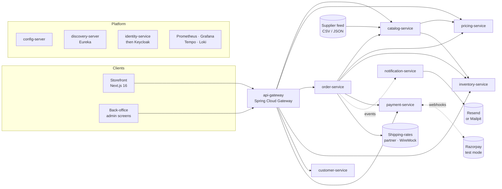

# ShopScope Commerce: Spring Boot and Microservices, end to end

**Status: draft outline v2.2, for review.** v2 re-bases the system on the commercetools B2C developer course
(`bff-java` + its Next.js `storefront`): the BFF's modules become ShopScope's services, each with its own
database, and the storefront is built from scratch in its own track. It also adds a **Testing** track and
plans a **Spring AI** track. v2.1 makes persistence polyglot: PostgreSQL, MySQL and MongoDB, chosen per service.
v2.2 starts from a plain-Java monolith (Demo 1) that the following demos migrate to microservices, and gives
every demo a journey title. The client TOC (`toc/`) will be rebuilt from this outline once it is agreed.

One enterprise e-commerce system, **ShopScope Commerce**, is built across every track. It starts as a
plain-Java monolith wired with `new`, a miniature of the whole backend in one process, and is migrated step
by step into a system with a Next.js storefront, seven business
services, a gateway, an identity provider, real payment and e-mail providers, containers, a CI/CD pipeline
and, later, events, Kubernetes and an AI assistant.

- **The storefront** is a Next.js 16 app built step by step in the *Next.js storefront* track, the same
  way the React ShopScope demos were built. Its shape follows the commercetools course storefront
  (App Router, `[locale]` routing with next-intl, Tailwind 4, SWR, a same-origin `/api/bff/*` proxy).
- **The backend** is a set of Spring Boot services, one per `bff-java` module. The BFF's four roles stay
  (`api`, `application`, `domain`, `infrastructure`), but `infrastructure` is now **our own database**
  instead of the commercetools SDK: PostgreSQL, MySQL or MongoDB, chosen per service, through Spring Data.
  No commercetools platform anywhere.
- **The integrations** are real providers in test mode: **Razorpay** for payments, **Resend** for e-mail
  (Mailpit as the offline adapter), plus a shipping-rates partner and a supplier feed behind WireMock.

Every demo is a link in one chain: **the starter of demo N+1 is demo N, finished.** Miss one, join at the next.

**Demo titles are steps in that journey**, not topic headings: each says what happens to ShopScope in that
session, with the topics underneath. Where a demo needs code that is not the lesson (the extracted services of
Demo 13, the Keycloak realm, the Compose files), that code is pre-built in the starter, so the labs stay on
the session's concepts.

---

## 1. The system you end up with



### From `bff-java` modules to ShopScope services

| `bff-java` module (course session) | ShopScope service | Owns | Data store | Port | Born in |
|---|---|---|---|---|---|
| `platform` (shared kernel) | `libs/shopscope-starter` | Request ids, the shopper session, `ProblemDetail` advice, logging, HTTP-client defaults | — | — | Demo 4, grows throughout |
| the price selection inside CT (S2 `pricing.resolve`, S4 promo, S5 price context) | `pricing-service` | Price lists per currency · country · channel · customer group, discount codes, cart discounts, tax rules, quotes, `/price-context` | in-memory → PostgreSQL | 8082 | Module of the monolith (Demo 1); extracted in Demo 13 |
| `project` (S1 stores, region) + `catalog` (S2) + `product-discovery` (S3) | `catalog-service` | Stores and channels, localised products, categories, variants, bundles, slugs, images, reviews, full-text search, facets, the PLP | PostgreSQL (JSONB, full-text, pgvector) | 8081 | Module of the monolith (Demo 1); extracted in Demo 12 |
| `cart` + `order` (S4, S6) | `order-service` | Carts, shopping lists, cart rules, checkout readiness, order numbers, orders, order states, the payment ledger view, subscriptions, order timeline | MySQL (InnoDB) | 8083 | Module of the monolith (Demo 1); extracted in Demo 13 |
| CT inventory (S4 stock gate, `inventory.read`) | `inventory-service` | Stock per supply channel, availability, inventory modes, reservations | PostgreSQL | 8084 | Module of the monolith (Demo 1); extracted in Demo 13 |
| `customer` (S5) | `customer-service` | Profiles with embedded address books, customer groups, e-mail verification, guest → customer cart merge, `/session` | MongoDB | 8085 | Module of the monolith (Demo 1); extracted in Demo 13 |
| `customer` sign-in (S5), then Keycloak | `identity-service` | Credentials, registration, password reset, JWT issuing, JWKS | PostgreSQL | 9000 | Demo 17 (replaced by Keycloak in Demo 20) |
| CT Checkout + payments (S6) | `payment-service` | Razorpay orders, signature verification, webhooks, capture, refunds, the ledger | MySQL | 8086 | Demo 23 |
| CT Subscriptions + the e-mail connector (S5, S7) | `notification-service` | Templates, Resend / SMTP adapters, delivery log and webhooks, the outbox consumer, the timeline event log | MongoDB | 8087 | Demo 24 |
| `extensibility` (S7) | spread across the above | Custom attributes (JSONB), feature flags (config), cart rules (a rule chain), order timeline (an event log), price-feed import (Spring Batch) | — | — | Demos 10, 14, 24, 25 |
| — | `config-server` | Configuration for every service | Git (`config-repo/`) | 8888 | Demo 14 |
| — | `discovery-server` | Service registry (Eureka) | memory | 8761 | Demo 15 |
| — | `api-gateway` | The single entry point, the `/api/*` contract, edge security, rate limits | Redis | 8080 | Demo 16 |
| `training` / Commerce Canvas | — | Not carried over. The storefront track replaces capability gates with demos. | — | — | — |

**Polyglot persistence, on purpose.** Database per service means each service picks the store that fits its
workload: PostgreSQL where we need JSONB, full-text search and later vectors (catalogue), MySQL where the
lesson is InnoDB transactions and locking (orders, the payment ledger), MongoDB where the data is a document
(a customer with an embedded address book, e-mail templates and a delivery log). Learners meet all three
through Spring Data, with the same `infrastructure` boundary, and see what changes and what does not.

**The `/api/*` contract.** The gateway exposes the same public routes as `bff-java` (`/api/products`,
`/api/plp`, `/api/cart`, `/api/checkout/session`, `/api/orders/{orderNumber}`, `/api/account`, `/api/session`,
…), each routed to the owning service. That keeps the storefront's data layer identical in shape to the
reference, and keeps one contract for the storefront, testing and AI tracks to build on.

**Supporting containers** (all in Docker Compose): PostgreSQL with pgvector (one database per SQL service on
PostgreSQL), MySQL, MongoDB, Redis,
Keycloak (8180), Mailpit (8025), WireMock (8089), Prometheus (9090), Grafana (3030), Tempo and Loki. Kafka
joins in the event-driven track; an LLM endpoint (Ollama locally, or an API key) in the Spring AI track.

---

## 2. Repository layout

```text
shopscope-java-microservices/
├── README.md                          the track at a glance: every demo, what you build, how to run it
├── COURSE-OUTLINE.md                  this file
├── CLAUDE.md                          authoring conventions (for anyone writing or updating a demo)
├── toc/                               the client TOC workbook and its generator
├── docs/
│   ├── architecture/                  system map, service catalogue, the /api contract, sequence diagrams, ADRs
│   └── conventions/                   API style guide, error contract, naming, ports, versions
├── study-notes/                       concept notes, numbered, each mapped to the demos that use it
│
├── spring-boot-and-microservices/     TRACK 1 · demos 00–25 · the backend
├── nextjs-storefront/                 TRACK 2 · demos 26–32 · the storefront, from scratch
├── testing/                           TRACK 3 · demos 33–36 · the whole pyramid, on the whole system
├── docker/                            TRACK 4 · demos 37–38
├── docker-compose/                    TRACK 5 · demos 39–40
├── github-actions/                    TRACK 6 · demos 41–42
├── event-driven/                      TRACK 7 · demos 43–46 (planned)
├── kubernetes/                        TRACK 8 · demos 47–50 (planned)
├── spring-ai/                         TRACK 9 · demos 51–54 (planned)
└── capstone/                          demo 54 (planned)
```

**Tracks are folders, demo numbers are global.** The chain runs straight through the tracks. Tracks 2 and 3
both start from the finished backend of Demo 25; Docker starts from the finished storefront and tests. Each
track can be sold on its own: its first starter is a working system, run with one command.

### Inside one demo

```text
spring-boot-and-microservices/12-the-first-cut-the-catalogue-becomes-a-service/
├── README.md              the step-by-step guide (format below)
├── WALKTHROUGH.md         the finished code, file by file, for reading after the session
└── starter/               Demo 11 finished, plus TODO(lab-x.y) markers for this demo's labs
    ├── pom.xml            the parent (aggregator) POM: Java and dependency versions in one place
    ├── compose.yaml       the local infrastructure this demo needs (PostgreSQL, …)
    ├── libs/shopscope-starter/
    ├── shopscope-monolith/   the modular monolith: pricing, order, inventory, customer modules still inside
    ├── catalog-service/      ← this demo extracts it
    ├── http/              .http request files per service (IntelliJ and VS Code REST Client)
    └── postman/           the same requests as a Postman collection
```

A storefront demo has the same three parts; its `starter/` is `site/` (the Next.js app) plus `backend/`
(the finished backend as a Compose file, so a frontend learner never builds Java).

The last demo of each track also ships a `solution/` folder.

**Inside a service**, packages are by feature (`com.shopscope.catalog.product`, `…catalog.search`,
`…catalog.store`). Inside a feature the four roles from `bff-java` keep their names, `api` (controllers and
view records), `application` (services and mappers), `domain` (plain records, no framework types) and
`infrastructure` (JPA or MongoDB entities and repositories, HTTP clients). The golden rule carries over:
**persistence and HTTP types never leak past `infrastructure`.** Swapping PostgreSQL for MongoDB in a service
changes that package and nothing else. ArchUnit enforces it in the testing track.

**Guide format** (the same as the React track): every lab is *Problem → Concept → Steps → Verify → Watch out
→ Challenge → In the real world*, with minutes. Starters carry `TODO(lab-x.y)` markers in the order the
guide walks through them. Each guide ends with interview questions on the demo's topics.

---

## 3. The chain, part by part

Minutes are lab time. Each session adds about 10 minutes for the opening and the wrap-up.

## Track 1 · Spring Boot and microservices: from a plain-Java monolith to a secured, observable system (Demos 00–25)

### Part 0 · Before Spring: the monolith we start from

#### Demo 00 · The Java you will write ShopScope in · ~205 min
Modern Java, practised on the domain pieces the monolith of Demo 1 is built from: `Money`, price scopes and
discount rules, baskets, catalogue lookups. Sold as the one-day pre-course bridge.
- Lab 1 Records, immutability and `Money` as a value object (25)
- Lab 2 Sealed interfaces and pattern matching: price scopes with a precedence, and discount rules (25)
- Lab 3 Lambdas, streams and collectors over a basket: totals, groupings, a report (30)
- Lab 4 `Optional`, exceptions and the rules of a clean API: catalogue lookups that cannot lie (20)
- Lab 5 Maven: lifecycle, dependencies, the wrapper (20)
- Lab 6 JUnit and AssertJ: the first tests (20)
- Lab 7 Executors and futures: quoting a thousand baskets at once, and the one line that becomes virtual
  threads on Java 21+ (10)
- Lab 8 An SQL refresher on the ShopScope schema, and plain JDBC once (so the ORM makes sense) (30)
- Lab 9 A first document in MongoDB (10)
- Lab 10 HTTP essentials with curl: methods, status codes, headers, JSON (15)

#### Demo 01 · ShopScope as a plain-Java monolith · ~120 min
The whole backend in miniature, in one process, with no framework: seven modules (catalog, pricing,
inventory, customer, order, payment, notification) behind the same `/api` contract the microservices will
later serve, with in-memory stores, a composition root made of `new`, a hand-written properties loader,
logging pasted into every method, and a hand-rolled HTTP layer on the JDK's `HttpServer`. It works. The demo
is about seeing why it will not keep working, and writing the list of problems the next 24 demos remove one
at a time. The code is pre-built; the labs read, run, break and measure it.
- Lab 1 Tour: the seven modules, their dependencies, and the arrows that should not exist (15)
- Lab 2 The composition root: wire the object graph by hand, in dependency order, then add one discount rule
  and count the files you had to touch (20)
- Lab 3 Try to unit-test `OrderService`: the hidden `new RazorpayGateway()` and why it cannot be replaced (15)
- Lab 4 Configuration by hand: the properties loader, hard-coded tax rates and ports, and what a second
  environment costs (15)
- Lab 5 Cross-cutting by hand: timing and audit logging copied into every service method (10)
- Lab 6 The shared in-memory store and the overselling bug: a payment that fails after stock was decremented (20)
- Lab 7 The hand-rolled HTTP layer: run it, call it with curl, break it with malformed JSON (15)
- Lab 8 Start-up and shutdown by hand: ordering, and a resource that never closes (10)
- Lab 9 The problem register: every pain in this demo, and the demo that fixes it (10)

**After Part 0:** a working plain-Java monolith and a written register of its problems. Every demo from here
removes at least one; the register is re-read at the end of each part.

### Part 1 · Spring takes over the monolith

#### Demo 02 · The container takes over the wiring · ~150 min
Spring Core: the container, bean definitions, injection, scopes, the lifecycle. The composition root of
Demo 1 becomes the container's job, and `OrderService` becomes testable.
- Lab 1 The wiring problem, and dependency injection by hand (the composition root, made explicit) (15)
- Lab 2 The container: `AnnotationConfigApplicationContext`, `@Configuration`, `@Bean` (20)
- Lab 3 **Every way to define a bean:** `@Component` and its stereotypes with scanning; `@Bean` methods and
  `@Import`; XML (read it, for legacy code); `FactoryBean`; programmatic registration (`BeanRegistrar`,
  `registerBean` with a supplier) (25)
- Lab 4 **Injection:** constructor vs setter vs field; optional dependencies; `@Primary`, `@Qualifier` and a
  custom qualifier; injecting `List` and `Map` (the discount-rule chain); `ObjectProvider` and `@Lazy` (25)
- Lab 5 Scopes: singleton vs prototype, the stateful-singleton bug, a prototype inside a singleton (15)
- Lab 6 **The bean lifecycle, traced end to end:** instantiation, population, `Aware` interfaces,
  `BeanPostProcessor` before, `@PostConstruct`, `afterPropertiesSet`, the init method, `BeanPostProcessor`
  after (where proxies appear), `@PreDestroy`, `SmartLifecycle` (25)
- Lab 7 `BeanFactoryPostProcessor` vs `BeanPostProcessor`: write one of each (15)
- Lab 8 Bean definition overriding, circular dependencies, and why constructor injection exposes them (10)

#### Demo 03 · Configuration, events and aspects move out of the business code · ~120 min
Spring Core: `Environment`, profiles, conditions, application events, AOP, the TestContext. Problems 4 and 5
of the register close.
- Lab 1 `Environment`, `@PropertySource`, `@Value` and SpEL replace the hand-written properties loader (15)
- Lab 2 Profiles: tax rules per region (`in`, `uk`, `us`) (15)
- Lab 3 `@Conditional`: a custom condition for a promotion engine (15)
- Lab 4 Application events: `OrderPlaced` reaches the notification module without a direct call;
  `@EventListener`, ordering, async listeners (20)
- Lab 5 **AOP:** proxies by hand, then JDK vs CGLIB; `@Aspect`, pointcuts and `@Around`; the pasted timing
  and audit code becomes one `@Audited` aspect (30)
- Lab 6 The self-invocation trap, which is why `@Transactional` and `@Cacheable` sometimes do nothing (10)
- Lab 7 Testing with the Spring TestContext: `@SpringJUnitConfig`, context caching, test profiles (15)

#### Demo 04 · The monolith becomes a Spring Boot application · ~120 min
Spring Boot: starters, auto-configuration, externalised configuration, Actuator, and our own starter.
- Lab 1 Add Boot: the parent, starters, `@SpringBootApplication` taken apart (20)
- Lab 2 **Auto-configuration:** delete the configuration Boot now provides; read the conditions report;
  override a bean with `@ConditionalOnMissingBean` (25)
- Lab 3 Externalised configuration: `application.yml`, the order of property sources, profiles,
  `@ConfigurationProperties` records with validation (20)
- Lab 4 **Write our own auto-configuration:** `libs/shopscope-starter`, holding request ids, a clock and the
  `ShopperSession` (anonymous id · active cart · signed-in customer); `AutoConfiguration.imports`;
  conditions on our own beans (25)
- Lab 5 `ApplicationRunner`, Actuator (health, info, beans, conditions, env) and the executable jar (20)
- Lab 6 Logging: levels per package, structured JSON logs, DevTools (10)

**After Part 1:** the same monolith, now a Spring Boot application with our own starter. Problems 1 to 5 and
8 of the register are closed; the hand-rolled HTTP layer, the shared store and the single process remain.

### Part 2 · A modular monolith, ready to split: REST and data

#### Demo 05 · The hand-rolled HTTP layer becomes a REST API · ~130 min
Spring MVC, resource design, the `/api` contract. The monolith becomes a multi-module build, one Maven
module per bounded context, which is what makes the later split a move rather than a rewrite.
- Lab 1 The multi-module build: a parent POM, one module per bounded context, dependency management, and the
  dependency rules the modules may not break (15)
- Lab 2 Spring MVC under REST: `DispatcherServlet`, handler mapping, message converters (15)
- Lab 3 REST resource design: URIs, methods, idempotency, status codes. The `/api` contract we keep (15)
- Lab 4 `GET /api/stores`, `/api/stores/{key}`, `/api/store-context`: the region (country · language ·
  currency) every later call is scoped by (20)
- Lab 5 `@RestController` CRUD for products replaces the `HttpServer` handlers: `ResponseEntity`,
  `Location`, `204` and `404` (25)
- Lab 6 DTOs as view records, mapping with MapStruct (the one generated mapper) and by hand, Jackson 3 (20)
- Lab 7 `.http` files, curl and Postman: a request collection that grows with the course (10)
- Lab 8 The pricing module gets `POST /quotes` and `GET /api/price-context` (10)

#### Demo 06 · One error contract, and an API people can read · ~115 min
- Lab 1 Bean Validation on requests, groups, a custom constraint (`@ValidSku`) (25)
- Lab 2 One error contract: `ProblemDetail` (RFC 9457) from `@RestControllerAdvice`, moved into
  `shopscope-starter` (25)
- Lab 3 Paging, sorting and filtering in the API contract (20)
- Lab 4 API versioning with Spring Framework 7's built-in support (15)
- Lab 5 OpenAPI 3 with springdoc, Swagger UI, and API-first vs code-first (20)
- Lab 6 Conditional requests with ETags (10)

#### Demo 07 · The catalogue leaves memory: Spring Data JPA on PostgreSQL · ~125 min
The catalog module moves to PostgreSQL. Boot's Docker Compose support starts the database; Docker itself is
taught in Track 4.
- Lab 1 JPA, Hibernate and Spring Data: who does what. The first `@Entity`, and the `infrastructure` boundary (20)
- Lab 2 Flyway migrations and seed data, and why `ddl-auto` stays off (20)
- Lab 3 **Localised data:** names, descriptions and slugs per locale (a JSONB column vs a translation table),
  locale fallback, slug routing (`/api/products/by-slug/{slug}`) (25)
- Lab 4 `JpaRepository`, derived queries, `@Query` (JPQL and native) (20)
- Lab 5 Paging, sorting and projections (interfaces, records) (20)
- Lab 6 Custom attributes as JSONB, and seeing the SQL (20)

#### Demo 08 · Relationships that perform · ~120 min
- Lab 1 Category tree, product, variants, images, reviews, store ↔ product: `@ManyToOne`, `@OneToMany`,
  `@ManyToMany`, the owning side (25)
- Lab 2 Variant matrix and bundles (a product composed of products), cascades, `orphanRemoval`, `equals`/`hashCode` (20)
- Lab 3 Catch the N+1 on the product list (15)
- Lab 4 Fix it three ways: `JOIN FETCH`, `@EntityGraph`, DTO projections (25)
- Lab 5 Batch fetching, open-in-view off, `LazyInitializationException` explained (20)
- Lab 6 Auditing (`@CreatedDate`, `@LastModifiedBy`) and soft delete (15)

#### Demo 09 · Search, facets and the product listing · ~110 min
Full-text search, facets and the composed listing, on PostgreSQL.
- Lab 1 Filters from the API to SQL with Specifications; store-scoped and category-subtree queries (25)
- Lab 2 Full-text search with `tsvector`, ranking and a generated column (25)
- Lab 3 Facets: counts per attribute, price ranges, and post-filtering semantics (25)
- Lab 4 `GET /api/plp`: one composed response (cards, facets, total, sort) and its caching (20)
- Lab 5 When PostgreSQL is not enough: OpenSearch and the search read model, as a preview of Track 7 (15)

#### Demo 10 · Carts, checkout and the overselling bug, fixed: transactions and concurrency · ~130 min
The order module moves to PostgreSQL with carts, checkout and orders. The cart is the order's write model;
the order is its immutable record. Problem 6 of the register closes: the shared in-memory store is gone and
a failed payment no longer leaves stock decremented.
- Lab 1 Cart and order aggregates on JPA: line items, a bundle as one unit, a Subscribe & Save line (25)
- Lab 2 The cart write model: quantities, shipping address, pickup vs delivery, shipping methods, discount
  codes, customer e-mail, the summary (`GET /api/cart`) (25)
- Lab 3 Cart rules as a rule chain (the gift message, the white-glove badge), with the `List` injection from
  Demo 2 (15)
- Lab 4 `@Transactional` at the service layer: what the proxy does, `readOnly`, rollback rules, propagation and
  isolation demonstrated; the Demo 1 overselling scenario, replayed and fixed (25)
- Lab 5 Two tabs, one cart: optimistic locking with `@Version`, and a retry. Pessimistic locking, and when (20)
- Lab 6 Checkout: the order number and idempotency key, the shopping list (wishlist), and
  `@TransactionalEventListener` for "order placed" (20)

#### Demo 11 · The safety net: tests every module keeps · ~80 min
The minimum before the system is split. The full pyramid is Track 3.
- Lab 1 The test pyramid for a service, and what belongs where (10)
- Lab 2 Unit tests: JUnit, Mockito, AssertJ, test-data builders for carts and products (25)
- Lab 3 `@WebMvcTest` with `MockMvcTester`: a controller and the error contract (20)
- Lab 4 `@DataJpaTest` with Testcontainers and `@ServiceConnection`, and context caching (25)

**After Part 2:** a modular Spring Boot monolith on PostgreSQL with a REST API, one error contract, tests and
no shared in-memory state. Only problem 7 of the register is open: it is still one process.

### Part 3 · From monolith to microservices

#### Demo 12 · The first cut: the catalogue becomes a service · ~120 min
The strangler pattern, applied: the catalog module becomes `catalog-service` with its own database, and the
monolith calls it over HTTP.
- Lab 1 **Architecture, not code:** monolith vs modular monolith vs microservices; bounded contexts;
  database per service; the strangler pattern; the ShopScope target map (20)
- Lab 2 Extract `catalog-service`: the Maven module becomes an application with its own PostgreSQL database
  and the `/api/products` routes; the monolith's catalog module becomes a client (25)
- Lab 3 The monolith calls the catalogue with `RestClient` (product snapshot at checkout), then through an
  `@HttpExchange` interface (25)
- Lab 4 Timeouts, connection pools and error mapping: a downstream `ProblemDetail` turned into our own (20)
- Lab 5 Correlation ids across processes, added to `shopscope-starter` (15)
- Lab 6 Running several processes locally: ports, profiles, a run script (15)

#### Demo 13 · The monolith is gone: pricing, inventory, orders on MySQL, customers on MongoDB · ~140 min
The four remaining modules are extracted the way Demo 12 extracted the catalogue; that code is pre-built.
The labs are the concepts that are new with each service, and the checkout that now spans four of them.
- Lab 1 `pricing-service` and `inventory-service` on PostgreSQL: the scoped price on every card and line;
  stock per supply channel, availability badges (`GET /api/inventory/{sku}`), inventory modes, the stock
  gate, reservations (25)
- Lab 2 `order-service` on MySQL: same Spring Data JPA, a different dialect, Flyway for MySQL, what differs
  (identity columns, `utf8mb4`, no JSONB); the Demo 10 locking test re-run on InnoDB row and gap locks,
  `REPEATABLE READ` (MySQL's default) vs `READ COMMITTED` (PostgreSQL's) (30)
- Lab 3 **`customer-service` on MongoDB:** why a customer is a document (profile with an embedded address
  book), Spring Data MongoDB, `@Document`, `MongoRepository` and `MongoTemplate`, indexes, schema evolution
  without migrations, `@DataMongoTest` with Testcontainers; customer groups and the price context (35)
- Lab 4 **Checkout across four services:** the order of the calls; what happens when step three fails; a
  manual compensation (30)
- Lab 5 Data that lives in two places: snapshots, eventual consistency, and the questions to ask. The last
  monolith module is deleted; problem 7 closes (20)

#### Demo 14 · Every service reads its configuration from one place · ~90 min
- Lab 1 `config-server` backed by a Git `config-repo/`: one file per service per profile (25)
- Lab 2 The client side: `spring.config.import`, fail-fast, retry (15)
- Lab 3 Secrets: encrypted values, provider keys (Razorpay, Resend), and what never goes into Git (20)
- Lab 4 Refresh at runtime with `@RefreshScope` and Actuator; feature flags (`GET /api/config/feature-flags`)
  and the limits of refresh (30)

#### Demo 15 · Services find each other · ~90 min
- Lab 1 `discovery-server` (Eureka) and registrations (20)
- Lab 2 Client-side load balancing: a `@LoadBalanced` `RestClient.Builder` across two instances (20)
- Lab 3 OpenFeign compared with HTTP interfaces, so you can read either (20)
- Lab 4 Health, heartbeats, self-preservation and what "down" means to a registry (20)
- Lab 5 Discovery vs platform DNS: why Kubernetes makes Eureka optional, as a preview (10)

#### Demo 16 · One front door: the API gateway, and the storefront arrives · ~110 min
- Lab 1 `api-gateway` with Spring Cloud Gateway: the `/api/*` contract as routes, predicates, `lb://` URIs (25)
- Lab 2 Filters: path rewriting, request ids, the shopper-session cookie, a custom global filter (25)
- Lab 3 CORS once, at the edge (10)
- Lab 4 Rate limiting with Redis (20)
- Lab 5 One OpenAPI page for every service, aggregated at the gateway (15)
- Lab 6 **The storefront arrives:** the finished Next.js storefront (Track 2's solution) runs against the
  gateway and browses the real catalogue (15)

**After Part 3:** the storefront browses products through the gateway; services find each other and read their
configuration centrally. The register of Demo 1 is empty; what follows makes the system secure, resilient,
observable and connected to the outside world.

### Part 4 · Security

#### Demo 17 · Who are you? `identity-service` and Spring Security fundamentals · ~110 min
- Lab 1 The security filter chain on every request, and what the default does (15)
- Lab 2 `SecurityFilterChain` as a bean; authentication vs authorisation (20)
- Lab 3 Users in PostgreSQL with `UserDetailsService`; BCrypt and `DelegatingPasswordEncoder` (25)
- Lab 4 Registration (`POST /api/customers/signup`), e-mail uniqueness, password rules, the password-reset
  token and the e-mail-verification token (`bff-java` Session 5) (25)
- Lab 5 CSRF (when it matters, when a stateless API turns it off), CORS, security headers (15)
- Lab 6 Method security with `@PreAuthorize` on the back-office endpoints (10)

#### Demo 18 · Tokens everywhere: JWT, resource servers and the session boundary · ~140 min
- Lab 1 A JWT, decoded: header, claims, signature; HMAC vs RSA (10)
- Lab 2 Login that issues an RS256 token with `JwtEncoder`; a JWKS endpoint (30)
- Lab 3 The other services become OAuth2 resource servers (validation via the JWKS URI) (25)
- Lab 4 Roles and scopes from claims to authorities (15)
- Lab 5 Refresh tokens with rotation and reuse detection, stored hashed (25)
- Lab 6 **Guest → customer:** `GET /api/session`, the anonymous cart merged on login with a merge mode
  (`bff-java`'s `customer.cartMerge`), sign-out (20)
- Lab 7 Logout, revocation and the bad-token checklist (15)

#### Demo 19 · Securing the calls between services · ~110 min
- Lab 1 JWT validation at the gateway, and token relay to services (25)
- Lab 2 Ownership: customers see only their own orders, addresses and shopping lists (25)
- Lab 3 Service-to-service calls: client credentials, and never forwarding a user token blindly (25)
- Lab 4 Security tests: `@WithMockUser` and the `jwt()` post-processor (20)
- Lab 5 The OWASP API Security Top 10, checked against ShopScope (15)

#### Demo 20 · Login leaves the building: Keycloak, OAuth2 and OpenID Connect · ~110 min
- Lab 1 Why teams stop running their own login. OAuth2 roles and flows, and OIDC (15)
- Lab 2 Keycloak in a container: realm, clients, roles, imported from JSON (25)
- Lab 3 Swap the issuer: the services trust Keycloak, and `identity-service` retires (20)
- Lab 4 **The storefront signs in with authorization code + PKCE:** through the gateway as a backend-for-
  frontend (`oauth2Login`, `TokenRelay`, an httpOnly cookie), compared with a public SPA client (30)
- Lab 5 Client credentials for back-office jobs; mapping realm roles (20)

**After Part 4:** customers register, sign in through Keycloak and place their own orders; admins manage the catalogue.

### Part 5 · Resilience and observability

#### Demo 21 · When inventory is slow: resilience patterns · ~120 min
- Lab 1 Break it on purpose: latency and failures injected into `inventory-service` (10)
- Lab 2 Timeouts everywhere, and why they come first (15)
- Lab 3 Retries with backoff and jitter, and idempotency keys so a retried POST is safe (25)
- Lab 4 Circuit breaker and fallbacks with Resilience4j (Spring Cloud CircuitBreaker) (25)
- Lab 5 Bulkheads and rate limiters (15)
- Lab 6 Spring Framework 7's built-in `@Retryable` and `@ConcurrencyLimit`, compared (15)
- Lab 7 Graceful degradation: the PLP without stock badges, checkout readiness (`GET /api/checkout/readiness`)
  and what the customer sees (15)

#### Demo 22 · One checkout, seen across five services: observability · ~120 min
- Lab 1 Actuator health groups, liveness and readiness (15)
- Lab 2 Micrometer metrics to Prometheus, and a Grafana dashboard per service (25)
- Lab 3 Distributed tracing with OpenTelemetry: one checkout followed across five services in Tempo (30)
- Lab 4 Structured logs to Loki, with the trace id in every line (20)
- Lab 5 Business metrics: orders per minute, payment failures (15)
- Lab 6 Alerts and SLOs: what to page on, what to ignore (15)

### Part 6 · Integrations: the enterprise edge

#### Demo 23 · Taking the money: Razorpay and webhooks (`payment-service`) · ~125 min
`payment-service` keeps its ledger in MySQL: money moves in transactions. Razorpay in test mode. The storefront opens Razorpay Checkout with an order id we created; we verify the
result and reconcile through webhooks. Other regions would plug another provider into the same port.
- Lab 1 The payment port and the Razorpay adapter: `POST /api/checkout/session` creates a Razorpay Order
  (amount in paise, `receipt` = our order number) (25)
- Lab 2 Idempotency keys on every money-moving call (15)
- Lab 3 Verifying the checkout result: the HMAC-SHA256 signature over `order_id|payment_id` (20)
- Lab 4 **Webhooks in:** `X-Razorpay-Signature` verification, replay protection, out-of-order delivery
  (`payment.authorized`, `payment.captured`, `payment.failed`, `refund.processed`), replayed locally from
  `.http` fixtures and a tunnel (ngrok) when you want the real thing (30)
- Lab 5 The payment ledger (`GET /api/orders/{n}/payments`), capture at fulfilment, refunds, and the guarded
  order state machine (`PUT /api/orders/{n}/state`) (25)
- Lab 6 WireMock as the Razorpay sandbox in tests: success, decline, timeout (10)

#### Demo 24 · Telling the customer: Resend, the outbox and partner APIs (`notification-service`) · ~120 min
- Lab 1 `notification-service` on MongoDB: templates and the delivery log as documents; Thymeleaf rendering;
  a `MailSender` port with two adapters, **Resend** (the Java SDK, test addresses `delivered@` and
  `bounced@resend.dev`) and **SMTP to Mailpit** for offline runs (30)
- Lab 2 Asynchronous delivery with `@Async`, a task executor, and the transactional outbox (first version) (25)
- Lab 3 The order timeline (`GET /api/orders/{n}/timeline`): an append-only event log in MongoDB fed from
  the outbox, and the idempotent consumer with a checkpoint (`bff-java`'s Messages, Session 7) (20)
- Lab 4 Resend delivery webhooks (Svix signatures) and e-mail verification end to end (15)
- Lab 5 A shipping-rates partner API through an HTTP interface client, plus resilience and WireMock contract tests (20)
- Lab 6 API keys, OAuth client credentials and mTLS: how partners authenticate (10)

#### Demo 25 · Feeding the catalogue: Spring Batch for supplier and price feeds · ~100 min
- Lab 1 Spring Batch: job, step, reader, processor, writer (20)
- Lab 2 Import a supplier CSV or JSON feed into the catalogue, with validation and a reject file (25)
- Lab 3 The price feed (`POST /api/import/prices`, `bff-java`'s Import API) into `pricing-service`, with a
  status endpoint (20)
- Lab 4 Restartability, chunking and skip policies; scheduling and triggering from the back-office (20)
- Lab 5 Export: an orders file for a finance/ERP system (15)

**After Track 1:** a customer can browse, sign in, check out, pay through Razorpay's test mode and receive a
confirmation e-mail through Resend. Suppliers feed the catalogue. This is the backend every later track starts from.

## Track 2 · The Next.js storefront, from scratch (Demos 26–32)

Built the way the React ShopScope demos were built, one feature per session, following the structure of the
commercetools course storefront. Each starter ships the finished backend as `backend/compose.yaml`, so this
track stands alone for frontend learners. Stack: Next.js 16 (App Router, `proxy.ts`), React 19, TypeScript,
Tailwind 4, next-intl 4, SWR, jose. The storefront **only talks to the gateway**, through its own
same-origin `/api/bff/[...path]` route, and holds no secrets but the session cookie.

#### Demo 26 · Foundations: App Router, design system and regions · ~120 min
- Lab 1 `create-next-app`, the App Router, layouts, server vs client components (20)
- Lab 2 Tailwind 4 and the ShopScope design system: header, footer, brand mark, announcement bar (20)
- Lab 3 `[locale]` routing with next-intl, `proxy.ts`, the locale cookie and message files (25)
- Lab 4 The same-origin BFF proxy route and the one `bff` client module (`BffResult`, never throws) (20)
- Lab 5 The region menu: country · language · currency from `/api/stores` and `/api/store-context` (25)
- Lab 6 Environment, `next.config.ts`, images, fonts (10)

#### Demo 27 · The catalogue: PLP and PDP · ~120 min
- Lab 1 Server components fetching `/api/products`; `fetch` caching, `revalidate` and tags (25)
- Lab 2 `products/[slug]`: the PDP, `generateMetadata`, `not-found`, `loading` and `error` boundaries (25)
- Lab 3 Category navigation and category cards from the category tree (15)
- Lab 4 The variant selector (variant matrix) and bundle contents (25)
- Lab 5 Product cards, `next/image`, the scoped price and the availability badge (20)
- Lab 6 Related products and home sections (10)

#### Demo 28 · Search and discovery · ~100 min
- Lab 1 The search bar and URL state: `searchParams`, `useSearchParams`, `useTransition` (20)
- Lab 2 The facet panel: filters, post-filtering, counts (25)
- Lab 3 Sort and pagination, Suspense and streaming (20)
- Lab 4 The PLP switch: `/api/plp` composed vs assembled on the client, and why the server wins (20)
- Lab 5 Store-scoped browsing: the region switch re-scopes the PLP (15)

#### Demo 29 · The cart and the wishlist · ~120 min
- Lab 1 The shopper session cookie and `useSession`; the guest cart (20)
- Lab 2 `useCart` with SWR: add to bag, quantities, optimistic updates and rollback (30)
- Lab 3 The bundle as one unit, the Subscribe & Save line, promo codes (20)
- Lab 4 Fulfilment: pickup vs delivery, shipping address, shipping methods, the order summary (25)
- Lab 5 The wishlist (`/api/shopping-list`), save for later, move to cart (15)
- Lab 6 Server actions vs route handlers: where a mutation belongs (10)

#### Demo 30 · Accounts and authentication · ~120 min
- Lab 1 Register, sign in, forgot/reset password, verify e-mail pages and forms (`AuthShell`) (30)
- Lab 2 The session: tokens in an httpOnly cookie with jose, `proxy.ts` protecting `/account`, the OIDC flow
  through the gateway BFF (30)
- Lab 3 The cart-merge dialog on sign-in (20)
- Lab 4 Profile, address book, default addresses, the price tier (customer group) (25)
- Lab 5 Sign out everywhere, and the error states (15)

#### Demo 31 · Checkout, Razorpay and orders · ~130 min
- Lab 1 The checkout wizard: address → shipping → payment; readiness from `/api/checkout/readiness` (25)
- Lab 2 **Razorpay Checkout.js:** load the script, open with the order id from `/api/checkout/session`,
  handle success and dismissal, post the result back for verification (35)
- Lab 3 The confirmation page: the order, its ledger, state and subscription (25)
- Lab 4 Order history and the order timeline (20)
- Lab 5 Failure paths: declined, abandoned, webhook not yet arrived (25)

#### Demo 32 · A production storefront · ~100 min
- Lab 1 `ProblemDetail` rendering, global error boundaries, feature flags from `/api/config/feature-flags` (20)
- Lab 2 Accessibility and Lighthouse: keyboard, focus, contrast, Core Web Vitals (25)
- Lab 3 A first Playwright smoke test (browse → bag → checkout); the deep dive is Track 3 (20)
- Lab 4 `next build` with `output: 'standalone'`, environment at build vs run time, ready for Docker (20)
- Lab 5 Deploying the storefront alone (Vercel or Netlify) against a hosted gateway, as an option (15)

Ships `solution/`.

## Track 3 · Testing, on the whole system (Demos 33–36)

Starts from the finished backend and storefront. Demo 11 gave each service a minimum safety net; this track
builds the whole pyramid, including the parts that only exist once there are many services and a UI.

#### Demo 33 · Unit testing done well · ~120 min
- Lab 1 JUnit 5 beyond the basics: parameterized, nested, dynamic tests, extensions (20)
- Lab 2 AssertJ custom assertions; test-data builders and object mothers for carts, products, orders (20)
- Lab 3 Mockito: strict stubs, argument captors, `BDDMockito`, and what not to mock (20)
- Lab 4 Property-based testing with jqwik on the pricing engine (20)
- Lab 5 Mutation testing with PIT: is the suite actually testing anything? (20)
- Lab 6 ArchUnit: the feature and layer rules (`domain` has no framework types; JPA stays in `infrastructure`) (20)

#### Demo 34 · Spring slice and integration tests · ~120 min
- Lab 1 `@WebMvcTest` and `MockMvcTester` in depth: validation, `ProblemDetail`, security with `jwt()` (25)
- Lab 2 `@DataJpaTest` and `@DataMongoTest` with Testcontainers for PostgreSQL, MySQL and MongoDB: Flyway,
  queries, N+1 assertions with Hibernate statistics (25)
- Lab 3 `@SpringBootTest` with `RestTestClient`; `@MockitoBean`; test profiles and configuration (25)
- Lab 4 Async and time: Awaitility for the outbox, `Clock` as a bean, `@Scheduled` under test (20)
- Lab 5 Keeping the suite fast: context caching, reusable containers, parallel execution (25)

#### Demo 35 · Testing between services · ~120 min
- Lab 1 Consumer-driven contracts between `order-service` and `catalog-service` with Spring Cloud Contract (or Pact) (35)
- Lab 2 Partners behind WireMock: Razorpay, Resend and the shipping API, including signed webhook fixtures (25)
- Lab 3 Testcontainers for Keycloak and Redis; gateway routing and security tests (25)
- Lab 4 Resilience under test: the circuit opens, the fallback answers, the retry stops (20)
- Lab 5 Test data: seeding, isolation, and resetting between tests (15)

#### Demo 36 · End-to-end and non-functional · ~120 min
- Lab 1 Playwright on the storefront: page objects, fixtures, stored auth state, trace viewer (35)
- Lab 2 Network control: mocking the BFF route, testing the locked and failed states (20)
- Lab 3 Load testing checkout with k6 (or Gatling): thresholds, the first bottleneck (25)
- Lab 4 Flaky tests: causes, quarantine, retries that hide bugs (15)
- Lab 5 Coverage with JaCoCo, a quality gate, and the test pyramid as CI stages (a preview of Track 6) (25)

Ships `solution/`.

## Track 4 · Docker (Demos 37–38)

Reuses the "Docker for Developers" workshop (5.1), applied to ShopScope's services and storefront.

#### Demo 37 · Containerising Spring Boot and Next.js · ~120 min
- Lab 1 Images, containers, layers and registries: the mental model (15)
- Lab 2 A multi-stage Dockerfile for `catalog-service` (25)
- Lab 3 Cache discipline, layered jars (`-Djarmode=tools`) and `.dockerignore` (20)
- Lab 4 The JVM in a container: memory, CPU, start-up time (20)
- Lab 5 **Harden it:** non-root; a minimal runtime image; a health check; hadolint and Trivy (25)
- Lab 6 The storefront image: Next.js standalone output, build-time vs run-time environment (15)

#### Demo 38 · Image builders, the system by hand, and registries · ~100 min
- Lab 1 Two more ways to build: Cloud Native Buildpacks and Jib, and when to pick each (25)
- Lab 2 Images for every service, one script (15)
- Lab 3 Run the whole system with plain `docker run`: networks, volumes, environment variables, and the pain
  that motivates Compose (35)
- Lab 4 Tags vs digests; pushing to GitHub Container Registry (15)
- Lab 5 Multi-architecture images, as a preview (10)

## Track 5 · Docker Compose (Demos 39–40)

Reuses the Docker Compose workshop (5.2), applied to ShopScope.

#### Demo 39 · The whole system in one Compose file · ~110 min
- Lab 1 One file, the whole stack (services, storefront, PostgreSQL, MySQL, MongoDB, Redis, Keycloak, Mailpit) (25)
- Lab 2 `depends_on` with health checks: start-up order that actually works (20)
- Lab 3 Networking: service DNS, and the fake incident (15)
- Lab 4 Environment variables and secrets discipline (`.env`, Compose secrets, provider keys) (15)
- Lab 5 Profiles: `observability`, `tools`, `partners` (WireMock in place of Razorpay and Resend) (20)
- Lab 6 An end-to-end smoke test: browse, sign in, check out (15)

#### Demo 40 · Compose for development and production-like runs · ~90 min
- Lab 1 Spring Boot's Docker Compose support vs a full-stack Compose file: which one when (15)
- Lab 2 `compose watch` and override files for a fast inner loop, Java and Next.js (20)
- Lab 3 Scaling a service behind the gateway; resource limits (20)
- Lab 4 Logging drivers, volumes, backups and restoring a database (20)
- Lab 5 The production-like profile: what Compose is not for (15)

## Track 6 · GitHub Actions (Demos 41–42)

Reuses the GitHub Actions CI/CD workshop, applied to ShopScope's repository.

#### Demo 41 · CI for a multi-service repository · ~110 min
- Lab 1 A minimal CI workflow: build and test with the Maven and npm caches (20)
- Lab 2 Fan-out and fan-in: a matrix over services, plus the storefront (20)
- Lab 3 Path filters: build only what changed (15)
- Lab 4 Testcontainers, Playwright and contract tests in CI; test reports, coverage and the quality gate (25)
- Lab 5 Reusable workflows and composite actions (20)
- Lab 6 Branch protection, required checks, Dependabot (10)

#### Demo 42 · Delivery: images, environments and releases · ~110 min
- Lab 1 Build, tag (commit SHA and semantic version), scan and push images to GHCR (25)
- Lab 2 OIDC federation to the cloud: no long-lived secrets (25)
- Lab 3 Environments with required reviewers: gated deploys to staging, then production (25)
- Lab 4 Release automation: changelog, version bump, GitHub release (15)
- Lab 5 Supply chain: SBOMs, provenance and signed images (20)

---

## 4. Planned extension tracks

| Track | Demos | What it adds to ShopScope |
|---|---|---|
| **Event-driven** (`event-driven/`) | 43 Kafka fundamentals · 44 Reliable consumers (retries, dead-letter topics, idempotency) · 45 The outbox done properly (Debezium) and the search read model (OpenSearch fed by product events) · 46 The checkout saga (order, inventory, payment), choreographed then orchestrated | Notifications, the timeline and the checkout move from synchronous calls to events |
| **Kubernetes** (`kubernetes/`) | 47 Kubernetes essentials · 48 Probes, configuration, secrets, autoscaling · 49 Helm charts for the system · 50 GitOps with Argo CD, and Eureka/Config replaced by platform services | ShopScope on a cluster, deployed from the GitHub Actions pipeline |
| **Spring AI** (`spring-ai/`) | 51 `ChatClient`, prompts, structured output and chat memory: a product Q&A assistant (`assistant-service`, port 8090) · 52 RAG over the catalogue with pgvector (embeddings from product data, the ingestion pipeline fed by catalogue events) · 53 Tool calling: check stock, track an order, add to bag, with the customer's token; guardrails and evaluation (relevance, factuality tests) · 54 An MCP server exposing ShopScope tools, and the storefront's assistant widget | A shopping assistant on the real system; Ollama locally, a hosted model in production |
| **Apache Camel** (`camel/`, client add-on, on request) | 56 Camel routes, beans, processors, files, JSON and XML · 57 Messaging through Camel: ActiveMQ and Kafka, HTTP from a route · 58 Enterprise integration patterns on the feed and the checkout: choice, multicast, content-based routing, splitter, aggregator, routing slip, dynamic router · 59 Camel in production: configuration, stand-alone vs Boot, logging, testing | Integration routes on the finished system, for clients with a Camel estate. First proposed for the 8-half-day request (see `proposals/`). |
| **Capstone** (`capstone/`) | 55 Production readiness, upgrading legacy Spring (Boot 2/3 → 4 with OpenRewrite), and a capstone service built and reviewed | A new service, e.g. reviews, recommendations, returns, or a Redis-backed cart split out of `order-service` |
| Later add-ons | Performance and caching (Redis, virtual threads, WebFlux) · a Nuxt storefront variant | — |

**Preparing the base system for Spring AI.** Decisions made now so the AI track needs no refactoring:
PostgreSQL ships with the pgvector extension from Demo 7; products carry rich localised descriptions and
JSONB attributes (Demo 7); `catalog-service` publishes product-changed events from Demo 24's outbox; every
service exposes an OpenAPI document (Demo 6), which is what the tools and the MCP server are generated from;
the `/api` contract is session-aware, so the assistant can act for the signed-in customer with their own
token (Demo 19).

---

## 5. Why this order

- **A monolith first (Demo 1).** Every pattern in the course is the answer to a problem, and problems are
  easier to feel than to describe. The plain-Java monolith makes them concrete, and its problem register is
  the thread the whole track follows.
- **Spring Core before Boot (Demos 2–4).** Boot is only "magic" if you've never wired beans by hand. Converting
  the same project to Boot in Demo 4 makes auto-configuration a visible diff. Writing our own starter proves
  learners understand it.
- **A modular monolith before microservices (Part 2).** REST, validation, JPA, search, transactions and the
  testing essentials are learned inside one process, organised as one Maven module per bounded context. By
  Part 3 the modules have real data, tests and clean boundaries, which is what makes the split a move
  rather than a rewrite.
- **The strangler pattern, lived (Part 3).** The catalogue is extracted first, by hand, with every
  consequence felt (Demo 12). The remaining services are extracted the same way but arrive pre-built
  (Demo 13), so the session stays on what is new: MySQL, MongoDB and a checkout across four services.
- **Security after the gateway (Part 4).** Edge validation, token relay and service-to-service credentials only
  make sense once there is an edge and services calling each other.
- **Resilience before integrations (Parts 5 → 6).** Partners are the least reliable dependencies. The patterns
  are learned on our own services, then applied to Razorpay, Resend and the shipping partner.
- **The storefront as its own track (Track 2).** Frontend learners get the backend as containers and build the
  store from scratch; backend learners see the finished store arrive in Demo 16. The shared `/api` contract is
  what makes the two tracks meet.
- **Testing as its own track (Track 3).** Contract tests, Playwright and load tests need the whole system.
  Demo 11 keeps the chain testable; Track 3 teaches testing properly, with the whole system to test.
- **Three databases, one boundary.** PostgreSQL first (Demo 7), MySQL when transactions are the lesson
  (Demo 10), MongoDB when the data is a document (Demo 13). Each arrives where its strengths are the topic,
  and the `infrastructure` boundary is what makes the choice local to one service.
- **Containers after the storefront and tests.** By Track 4 there is a real full-stack system, with a test
  suite, worth containerising and pipelining.
- **Spring AI last among the planned tracks.** An assistant is only convincing on a real catalogue with real
  orders, with tools that act through the secured `/api` contract.

## 6. Stack and versions (pinned in the parent POM at authoring time)

- **Language and framework:** **Java 17 baseline** (every starter compiles with `--release 17` and runs on 17,
  21 and 25, so no participant is blocked by their JDK); Java 21+ features such as virtual threads and
  pattern-matching `switch` are shown as asides, never required. Spring Boot 4.x (Spring Framework 7, Spring
  Security 7, Hibernate 7, Jackson 3), which supports Java 17; the Spring Cloud release train matching Boot 4;
  Spring AI 2.x in Track 9.
- **Build:** Maven with the wrapper.
- **Data:** PostgreSQL with pgvector, MySQL, MongoDB; Spring Data JPA and Spring Data MongoDB; Flyway for
  both SQL engines; MapStruct, springdoc-openapi.
- **Storefront:** Next.js 16, React 19, TypeScript, Tailwind 4, next-intl 4, SWR, jose.
- **Providers:** Razorpay (test mode, `razorpay-java`), Resend (`resend-java`), Mailpit for offline e-mail.
- **Testing:** JUnit 5, AssertJ, Mockito, jqwik, PIT, ArchUnit, Testcontainers, WireMock, Spring Cloud Contract,
  Awaitility, Playwright, k6.
- **Security and resilience:** Keycloak, Resilience4j.
- **Observability:** Micrometer, OpenTelemetry, the Prometheus/Grafana/Tempo/Loki stack.
- **Infrastructure:** Redis, Spring Batch.
- **Delivery:** Docker, Compose, GitHub Actions.
- **No Lombok.** Records and plain Java keep the code readable in a training setting.
- **Packages** are `com.shopscope.<service>.<feature>`, with `api`, `application`, `domain` and
  `infrastructure` inside a feature.

## 7. What we reuse

| Source | Becomes |
|---|---|
| `commercetools-sdk-developer-java-training` · `bff-java` (modules, the four roles, the `/api` contract, domain records, view records) | The service boundaries and the API contract of Track 1. The `Ct*Repository` classes are replaced by JPA; `application`, `domain` and `api` carry over in shape. Branding, Canvas and anything commercetools-specific do not. |
| `commercetools-sdk-developer-java-training` · `storefront/site` (App Router layout, `proxy.ts`, the BFF proxy route, hooks, components) | Track 2, rebuilt step by step without the capability gates |
| `reva-java-0202-batch` · Spring Core examples (week 4) | Demos 02–03 (rewritten around the pricing engine) |
| `reva-java-0202-batch` · JPA demos and the entity-relationships docs (weeks 4–5) | Demos 07–08, 10 |
| `reva-java-0202-batch` · Spring Web REST API with docs 00–12 (week 5) | Demos 05, 06, 11, 17–18 |
| `reva-java-0202-batch` · microservices mini-project, step-by-step guide modules 1–12 | Demos 12–16, 18–19; parts of 36 and 40 |
| `react-shopscope-demos` · the guide and lab format | Every guide; Track 2 follows its session rhythm |
| `playwright-demos` | Demo 36 (and the smoke test in Demo 32) |
| `ai-native-workshops/5-1-workshop-02-Sep` · Docker for Developers | Demos 37–38 |
| `ai-native-workshops/5.2-docker-compose-workshop` | Demos 39–40 |
| `ai-native-workshops/gh-workshop-17-aug` · GitHub Actions CI/CD | Demos 41–42 |

The Java reference projects use Java 17 or 21, Spring Boot 3.5 and Spring Cloud 2025.0. Everything is ported
to Spring Boot 4 on the Java 17 baseline, which mostly means Spring Security 7 configuration, Jackson 3, and `RestClient` in
place of `RestTemplate`. The commercetools training repository belongs to commercetools; we reuse its design
and contract, not its code or brand.

## 8. Rough size

| Track | Demos | Lab minutes (approx.) | Days (6 teaching hours) |
|---|---|---|---|
| 1 · Spring Boot and microservices | 00–25 | 3,100 | 8.5 |
| 2 · Next.js storefront | 26–32 | 810 | 2.5 |
| 3 · Testing | 33–36 | 480 | 1.5 |
| 4 · Docker | 37–38 | 220 | 1 |
| 5 · Docker Compose | 39–40 | 200 | 1 |
| 6 · GitHub Actions | 41–42 | 220 | 1 |

The client TOC will offer a **5-day core** cut from Parts 1–4 and Part 3's microservices essentials, with every
other part and track as a one- to three-day add-on. That cut is the next step once this outline is agreed.
